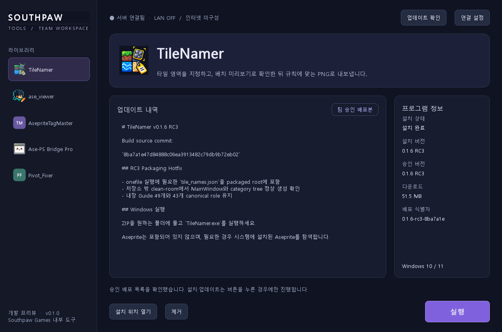

# Southpaw Tools Launcher v0.1.0 — 개발 결과

> 이 문서는 해당 개발 단계의 기록입니다. 이후 로컬 체크포인트 승인·검사 결과는 [LOCAL_CHECKPOINT_REVIEW.md](LOCAL_CHECKPOINT_REVIEW.md)를 따릅니다. 과거 Git 상태·제한 및 초기 설계 내용은 현재 상태와 다를 수 있습니다.

검증일: 2026-11-03 KST. **실제 설치 엔진과 서버가 동작하는 첫 소스 개발본**이다.
정식 공개/배포용 런처 EXE는 만들지 않았다.

## 1. 위치와 Git baseline

- 새 소스 위치: 현재 Codex `통합 클라이언트 만들기` 프로젝트 루트.
- 시작 상태: `.git`만 존재, master 브랜치, 커밋 없음, remote 없음.
- 기존 사용자 소스가 없음을 확인하고 같은 독립 저장소에만 파일을 생성했다.
- 기존 개발 프로그램 5개의 소스 폴더는 읽기 전용으로 취급했다.
- commit/stage/push/remote 설정/태그 변경은 하지 않았다.

## 2. 구조

```text
southpaw_tools/
  __main__.py             런처 진입점과 격리 UI 검사
  ui.py                   PySide6 UI / 비동기 작업
  catalog.py              등록 규격·검증·배포 식별
  providers.py            로컬/LAN HTTP / 미구성 인터넷 경계
  installer.py            설치·업데이트·실행·제거
  archive.py              ZIP/EXE/리소스 검사와 안전한 추출
  processes.py            실행 및 Windows 프로세스 경로 탐색
  common.py, paths.py     atomic JSON / OS lock / 안전 경로
  server.py               읽기 전용 배포 서버
  admin.py                관리자 PC 전용 승인 게시 CLI
  data/catalog.json       초기 프로그램 목록
  assets/                 기존 도구 아이콘 복사본
distribution/
  catalog.json, server.json
  packages/               승인 ZIP 4개 복사본, Git 제외
tests/                    더미 패키지·HTTP·Qt 테스트
tools/                    승인 패키지 등록·검증 도구
docs/                     설계·운영·데이터 정책·화면·로컬 검증 결과
```

## 3–4. 승인 파일과 등록

| 표시 이름 | 기준 | 결과 | ZIP 내부 EXE / cwd |
|---|---|---|---|
| TileNamer | 0.1.6 RC3 | 해시·CRC·EXE 검증, 원본 ZIP 복사 | TileNamer.exe / . |
| ase_viewer | 0.5.8.3 | 해시·CRC·EXE·예제 경로 검증, 원본 ZIP 복사 | ase_viewer.exe / . |
| AsepriteTagMaster | 기존 0.4.0 / 7263f8d | 승인 ZIP 미확인, 설치 비활성 | 예정 AsepriteTagMaster.exe / . |
| Ase-PS Bridge Pro | 0.3.6 | 해시·CRC·EXE 검증, 원본 ZIP 복사 | bridge_ui.exe / . |
| Pivot_Fixer | 0.3.3 | 해시·CRC·EXE·Onedir 구조 검증, 원본 ZIP 복사 | Pivot_Fixer_v0.3.3/Pivot_Fixer_v0.3.3.exe / Pivot_Fixer_v0.3.3 |

전체 ZIP·EXE SHA-256, release_id, 크기, 데이터·리소스 위치는 [PROJECT_REGISTRY.md](../PROJECT_REGISTRY.md)에 기록했다.
`docs/package-audit.local.json`은 실제 원본 절대 경로를 포함하는 로컬 상세 결과이며 Git에서 제외한다.

Viewer의 0.5.8.4 ZIP, 0.5.8.5 소스, Tag Master 분할 기능, Bridge 0.3.7, TileNamer 후속 UI는 사용하지 않았다.
Tag Master의 기존 EXE는 확인했지만 이를 임의로 재압축해 승인 ZIP을 대체하지 않았다.
Pixel Effect Maker와 Pixel Motion Studio는 모든 런처 대상에서 제외했다.

## 5. UI와 실제 동작

- 남색·보라색 테마, 5개 도구 사이드바, 소개, 승인/설치 버전, 릴리즈 노트.
- TileNamer/Viewer/Bridge는 기존 실제 아이콘 복사본, 나머지는 기본 배지.
- 설치·업데이트·실행·현재 버전 실행·제거·위치 열기·업데이트 확인·연결 설정.
- 전송 진행률·취소·실패 사유, 서버 연결과 LAN/인터넷 상태 표시.
- 미확인 패키지, 미연결 서버, 실행 중 상태에 맞춘 버튼 차단.
- 네트워크/압축/파일 작업은 QThread, UI 갱신은 GUI 스레드.

격리된 실제 승인 패키지 설치 후 서버 목록을 조회한 화면:



이 화면의 설치 상태는 `.test-results/approved-client-*` 검증 폴더 기준이다.
사용자 기본 설치 영역에 프로그램을 몰래 설치하거나 해당 EXE를 실행하지 않았다.

## 6–7. 자체 서버와 네트워크

- 별도 프로세스, Python 표준 라이브러리 기반 읽기 전용 API.
- 상태·카탈로그·앱 버전·노트·승인 ZIP 제공. 게시/업로드 API 없음.
- 기본 localhost listener만 ON. 외부/LAN 포트를 열지 않았다.
- 전체 OFF: listener 없이 종료. 실행 중 서버는 Ctrl+C로 포트 정리.
- LAN: 명시 설정, 정확한 사설 IPv4, 24자 이상 ASCII 토큰이 필요하다.
- LAN listener 준비 실패 시 기존 로컬 listener도 정리하고 시작 실패를 보고한다.
- 인터넷: 미구성. 활성화 요청을 거부한다. 공유기·방화벽·터널 설정 없음.
- LAN 정책·토큰과 바인딩 실패 정리는 loopback/모의 조건으로 테스트했다.
- **실제 회사 LAN의 다른 PC 연결은 아직 검증하지 않았다.**

서버 설정 변경은 재시작 후 반영된다. LAN HTTP는 암호화되지 않으므로 회사가 승인한 신뢰 가능한 내부망에서만 검토한다.
자세한 사용법: [SERVER.md](SERVER.md).

## 8–9. 설치·실행·업데이트 검증

### 실제 승인 패키지

실제 loopback HTTP로 승인 ZIP 4개를 다운로드해 격리 폴더에 설치했다.

- TileNamer, Viewer, Bridge, Pivot 설치 및 EXE SHA-256 검사 PASS.
- Viewer 한글 예제 리소스 10경로 존재 PASS.
- Pivot 역슬래시 ZIP 경로를 정규화한 Onedir 구성과 cwd PASS.
- 서버 종료 후 로컬 설치 메타데이터만으로 4개 실행 경로·cwd 해석 PASS.
- 실제 UI에서 서버 카탈로그 조회, 설치 완료/실행 버튼 표시 PASS.
- **기존 프로그램 EXE 실행 0회. Photoshop/Aseprite 실행·종료 0회.**

기계 판독 결과: `docs/approved-install-verification.local.json`.

### 더미 패키지

- 설치 후 설정·서버 연결 정보가 없어도 오프라인 실행 요청 가능.
- 새 release_id를 사용하면 같은 version 문자열이어도 업데이트 감지.
- 같은 release_id의 해시 변경, 잘못된 버전/경로/크기/EXE 해시/누락 리소스 차단.
- 다운로드 중단/취소, 해시 오류, 사용자 데이터 복사 실패, 활성화 저장 실패 시 이전 설치 유지.
- 설치 도중 앱이 실행되면 활성 버전 전환 보류.
- 이전 버전·알 수 없는 사용자 파일·수정된 리소스 보존.
- 명시된 설정만 이전, 실행 코드 확장자와 링크/정션의 자동 이전 차단.
- 수정된 EXE 실행 거부, 변경/사용자 파일을 보존하는 제거.
- 프로세스 간 잠금과 Windows 실행 파일 경로 조회.
- 경로 탈출·UNC·드라이브·ADS·예약 이름·NUL·대소문자 충돌·링크 ZIP 차단.
- 읽기 전용 API·미게시 다운로드 차단·리다이렉트 차단·게시 실패 정리.
- Qt UI 버튼으로 더미 설치 → 업데이트 → 오프라인 실행 요청 → 실행 중 변경 차단.

새 활성 버전은 atomic 포인터 교체로 선택하며 이전 release를 덮어쓰지 않는다.
미등록 작업물은 이전 버전에 남기고 자동 이전/병합하지 않는다.

## 10. 기존 프로젝트 보존

작업 전 baseline과 비교:

| 기존 폴더 | 검사 파일 수 | 파일 해시 / HEAD / 태그 / Git 상태 |
|---|---:|---|
| AI | 107 | 모두 동일 |
| AI TS | 36 | 모두 동일 |
| AsepriteTagMaster_Source | 19 | 모두 동일 |
| Pivot Fixer | 8 | 모두 동일 |
| TileNamer | 122 | 모두 동일 |

총 292개는 Git tracked/untracked 대상 파일이며 ignored 파일 전체를 센 값이 아니다.
추가로 사용한 원본 승인 ZIP 4개의 SHA-256이 고정 승인값과 일치함을 확인했다.
기존 원격·미푸시 커밋·미커밋 변경·태그는 보존했다.
`tools/verify_existing.py`와 `docs/existing-projects-verification.local.json`에 근거가 있다.

## 11. 최종 자동 검사

- **42 tests / failures 0 / errors 0 / skipped 0 / PASS** (12.066초).
- Windows 11 build 26200, Python 3.13.7, PySide6/Qt 6.11.0.
- Python AST 23개 파일, pyproject TOML 파싱 PASS.
- Offscreen UI 100/125/150%: DPR 1.0/1.25/1.5, 5개 등록과 창 생성 PASS.
- 980×700 / 1240×820 / 1600×1000 레이아웃과 버튼 경계 검사 PASS.
- Windows Use 0회. GUI는 Qt Offscreen만 사용했다.

결과: `.test-results/unit-tests.json`, `.test-results/unit-tests.log`, `.test-results/dpi-checks.json`.
테스트 중 Qt의 반복 짧은 대기에서 Python worker가 지연되는 경우가 있어 실제 QEventLoop의 완료 신호 대기로 수정했다.
시간 제한·완료 assertion은 유지했으며 최종 전체 suite가 통과했다.
초기 샌드박스에서는 loopback도 WinError 10013으로 막혀, 실제 HTTP 검증은 127.0.0.1만 허용한 샌드박스 밖 실행으로 수행했다.

## 12. 미완료/후속

- Tag Master 승인 ZIP 확보.
- 실제 회사 LAN 다른 PC·방화벽·정책 확인.
- 실제 Windows 10과 물리 모니터 DPI·키보드·IME·접근성 QA.
- 사용자 승인 후 기존 5개 프로그램 실기동과 실제 사용자 설정 쓰기 위치·호환성 QA.
- 제거 중 권한/디스크 실패 재시도 UX, 설치 복구·수동 롤백·이전 버전 정리 UI.
- 관리자 GUI, 서명된 메타데이터, TLS/인터넷 provider, 토큰 보관 보강.
- 런처 최종 EXE·Installer·서명·자체 업데이트.

자체 업데이트는 별도 updater를 설계해야 하며 실행 중인 런처 EXE를 자기 덮어쓰지 않는다.

## 13. GitHub 계획

[ROADMAP.md](../ROADMAP.md)에 다음을 기록했다.

> 회사 GitHub 계정에 연결된 저장소를 개인 계정으로 이전하는 작업 — 코드 소유권과 이전 권한 확인 후 진행

기존 앱의 GitHub 최신화는 각 앱의 다음 정식 릴리즈 검증 시 개별 진행한다.
기존 remote 변경·force push·회사 계정 자동 연결은 하지 않았다.

## 14–15. Git과 배포 상태

새 저장소는 커밋 없는 master 상태다. 새 코드·테스트·문서는 untracked이며 staging은 비어 있다.
실제 패키지·격리 설치·테스트 캐시·원본 경로 포함 로컬 보고서는 Git에서 제외했다.

**commit 0 / push 0 / tag 변경 0 / 정식 외부 배포 0 / 런처 EXE 빌드 0.**
검증용 서버는 모두 종료했다. 사용자 서버는 `run_server.bat`, 런처는 `run_launcher.bat`으로 시작할 수 있다.
