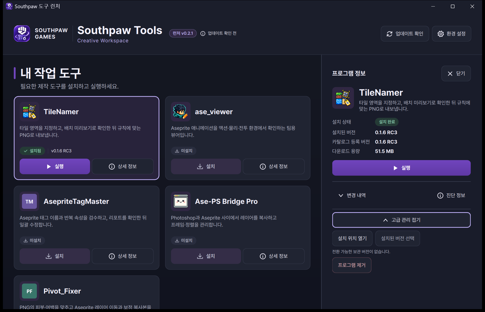
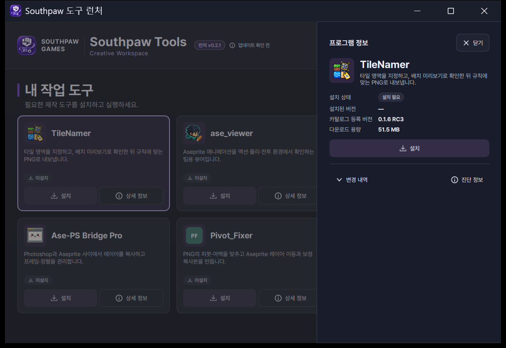
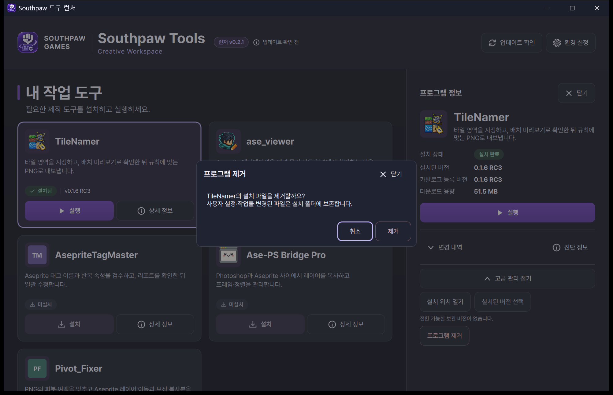
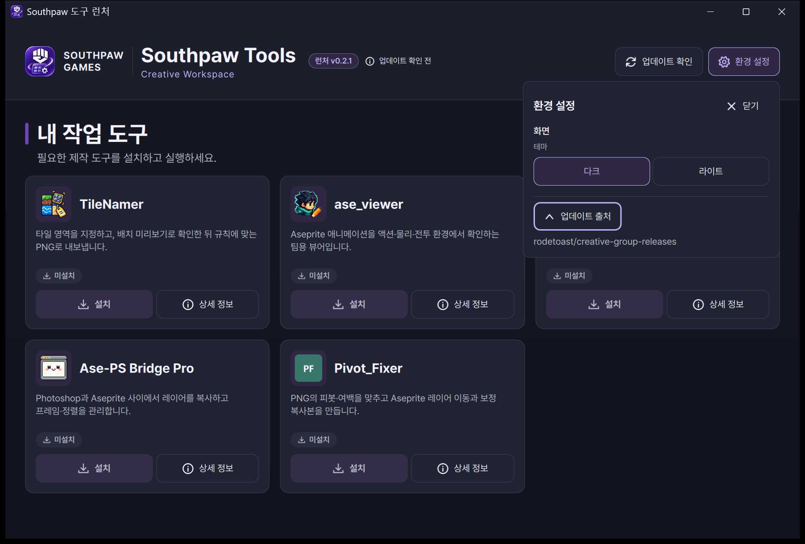
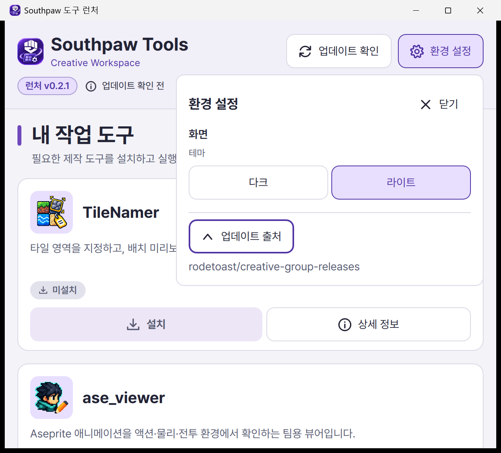

# Southpaw Tools 0.2.1 Windows UI 검토

Windows 격리 프로필에서 촬영한 0.2.1 화면입니다. 공개 카탈로그의 앱 이름·아이콘과 격리된 설치 상태를 사용했습니다. 운영 서명 후보의 업데이트 검증은 [별도 배포 기록](../../LAUNCHER_UI_AND_STARTUP.ko.md)을 참고하세요.

## 설치된 앱의 고급 관리

150% 배율. 상세 패널에서 고급 관리를 펼친 상태입니다. 설치 위치를 열 수 있고, 전환 가능한 보관 버전이 없으면 버전 선택이 비활성화됩니다.

## 미설치 앱의 상세 패널

100% 배율. 설치 상태와 등록 버전이 표시되고 고급 관리 섹션은 숨겨집니다. 이 캡처에서는 온라인 확인 전이라 설치 버튼이 비활성 상태입니다.

## 프로그램 제거 확인

150% 배율. 제거 대상과 보존 범위를 표시합니다. 최초 포커스는 취소에 있고, 닫기로 빠져나올 수 있습니다.

## 환경 설정 · 다크

150% 배율. 헤더 버튼 아래에 팝오버가 열리고 선택된 테마와 읽기 전용 업데이트 출처가 보입니다.

## 환경 설정 · 라이트

200% 배율의 620×540 논리 픽셀 창입니다. 라이트 테마 선택과 펼친 업데이트 출처가 창 안에 배치됩니다.

