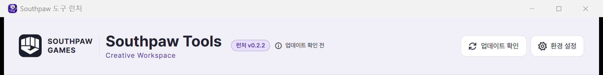

# Southpaw Tools 헤더 브랜딩 검토

Southpaw Games의 공식 회사 심볼을 QML 헤더에 적용했다. 제목 표시줄의 보라색 아이콘은 런처의 제품 아이콘이다. 2026-11-23 사용자 승인을 근거로 회사 심볼과 Windows 검토 화면을 공개한다. [공식 홈페이지](https://southpaw.games/) · [심볼 원본](https://southpaw.games/wp-content/uploads/2022/07/Logo_White-4.png)

## 변경 전 · 0.2.1

기존 헤더에서 런처 아이콘과 회사명이 한 그룹에 배치됐다.

## 변경 후 · 다크 100%

흰색 공식 심볼의 투명 배경을 유지했다.

## 변경 후 · 라이트 150%

같은 심볼을 짙은 바탕 위에 배치해 대비를 확보했다.

## 변경 후 · 좁은 창 200%

620 논리 픽셀에서 회사 심볼과 제품명이 첫 줄에, 버전과 조회 상태가 둘째 줄에 표시된다.

