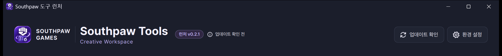
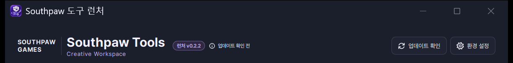
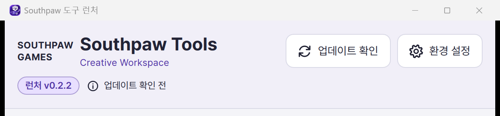

# Southpaw Tools 헤더 브랜딩 검토

QML 헤더의 회사 표시와 Windows의 제품 아이콘을 분리했다. 아래 공개 캡처는 공식 회사 심볼 파일의 재배포 범위를 확인하기 전까지 회사명을 텍스트로 표시하는 개발 빌드의 화면이다. 로컬 0.2.2 후보에는 공식 심볼이 포함된다. [Southpaw Games 공식 홈페이지](https://southpaw.games/)

## 변경 전 · 0.2.1

기존 헤더에서 런처 아이콘과 회사명이 한 그룹으로 배치됐다.

## 변경 후 · 다크 100%

공개 검토용 텍스트 표시에서 회사명, 제품명, 버전, 조회 버튼 배치를 확인했다.

## 변경 후 · 라이트 150%

라이트 테마에서 기존 제목 표시줄과 오른쪽 작업 버튼을 확인했다.

## 변경 후 · 좁은 창 200%

620 논리 픽셀 폭에서 버전·조회 상태가 둘째 줄에 배치된다.

