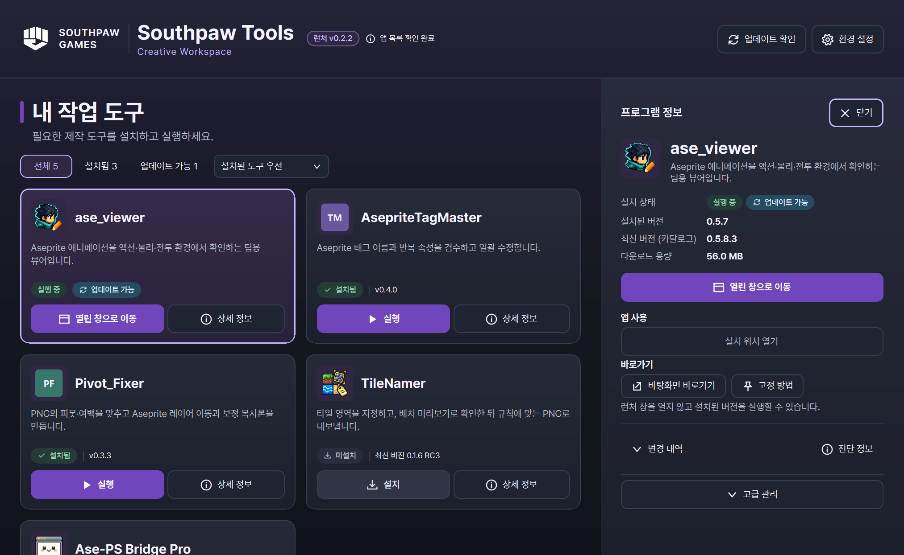

# 작업 공간 후속 Windows 검토

2026-11-25 · GUI 0.2.2 기반 개발 소스 · 이 갤러리와 같은 커밋의 QML

Windows Qt 창을 150%로 실행했습니다. 설치 상태·버전·도구 실행 및 설치 성공은 합성 데이터입니다. [이전 구현](../workspace-refinement-20261125/README.md)과 비교할 수 있습니다.

| 화면 | 검토 항목 |
| --- | --- |
| [다크 작업 공간](dark-running-update.png) | 정렬 화살표 대비, 실행 중·업데이트 가능 상태 동시 표시 |
| [도구 상세](shortcut-actions.png) | 실행·업데이트 상태와 아이콘이 있는 바로가기 액션 행 |
| [라이트 설치 완료](light-install-toast.png) | 목록 위치를 유지하는 비차단 안내 |
| [좁은 창 설치 완료](narrow-install-toast.png) | 620 논리 픽셀에서도 안내와 주요 동작 유지 |

