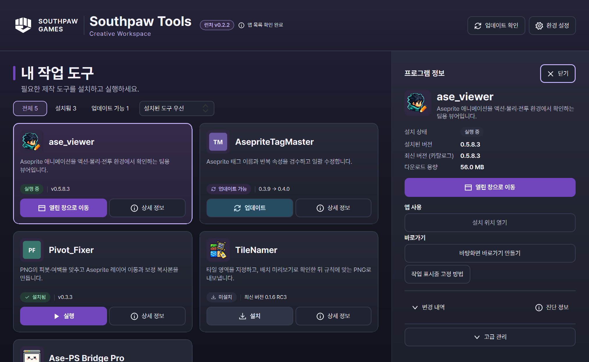

# Southpaw Tools Launcher 작업 공간 검토

2026-11-25 · GUI 0.2.2 기반 후속 개발 · 같은 커밋의 QML 소스

[디자인 명세와 HTML 시안](../../design-references/workspace-refinement-20261125/README.md)을 기준으로 실제 Windows Qt 창에서 캡처했습니다. 도구 설치, 다운로드 가능 여부, 실행 중 상태와 설치 완료 알림은 격리된 합성 상태입니다. 화면 내 버전·용량은 운영 배포 근거로 사용하지 않습니다.

| 화면 | 상태 |
| --- | --- |
| [다크 작업 공간](dark-workspace.png) | 150%, 전체 5개, 실행·설치·업데이트 버튼 |
| [라이트 작업 공간](light-workspace.png) | 150%, 라이트 표면과 버튼 대비 |
| [실행 중 도구 상세](running-detail.png) | 150%, 열린 창으로 이동과 바로가기 영역 |
| [설치 완료 안내](installed-notice.png) | 150%, 사용자가 선택하는 실행·바로가기·닫기 |
| [좁은 작업 공간](narrow-workspace.png) | 620 논리 픽셀, 150%, 설치됨 필터와 최근 업데이트순 |
| [좁은 100%](narrow-100.png) · [좁은 200%](narrow-200.png) | 620 논리 픽셀, Qt 렌더링 배율별 검토 |

